
<b> 软件设计与建模实验报告 </b>

 寇裕林 241220001 

****

### 一、项目的主要功能

余闲二手交易系统面向个人用户的闲置物品和一次性交付服务交易，将商品发布、买卖沟通、下单付款、履约确认及评价组织在同一个平台中。买家在商品详情中选择数量和交付方式，提交订单后完成模拟付款；平台记录暂存金额，在交易完成后生成卖家的模拟结算记录。普通账号同时具有购买和出售功能，用户根据具体交易承担买家或卖家角色。管理员负责商品审核、举报处理和订单纠纷，并通过单独授权获得管理权限。

按照功能，可以划分出七大模块。模块按照业务职责划分，每个模块管理自己的业务数据，涉及多个模块的交易操作由订单模块统一协调，具体如下表。

| 模块 | 主要功能 | 与其他模块的联系 |
| --- | --- | --- |
| 账号与权限 | 注册登录、身份会话、管理员授权、业务对象访问校验 | 为接口层提供身份与权限判断，授权操作写入日志 |
| 商品与审核 | 商品查询、详情、草稿、图片、审核、修改、上下架及可售库存管理 | 向订单模块提供商品信息和库存操作，接收举报处理产生的商品处置 |
| 订单与履约 | 直接下单、交易快照、交付、确认完成、取消协商及处理意见执行 | 协调商品库存与模拟资金，同时生成通知和操作记录 |
| 模拟资金 | 付款、平台暂存、退款、结算和售后资金调整 | 在订单业务事务中执行资金变化，为卖家统计提供数据 |
| 沟通与评价 | 商品咨询、交易沟通、业务通知和双向评价 | 会话关联商品与订单，评价关联完成订单及双方用户 |
| 举报与纠纷 | 商品举报、聊天举报、订单纠纷、客服处理和结果反馈 | 商品处置交给商品模块，订单与资金处置通过订单模块执行 |
| 统计与审计 | 卖家成交统计、模拟到账统计、管理待办和操作日志 | 汇总订单、资金、审核及案件数据，保留关键操作前后值 |

****

### 二、软件架构与 UML 建模

#### 2.1 前后端架构组件图

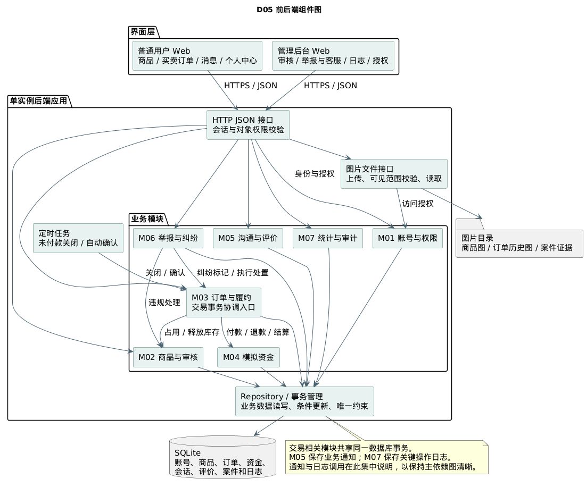

把订单与履约模块放在交易协作的中心，是因为交易、订单是整个项目的核心功能，并且下单、取消和确认完成都会同时影响几类数据。例如，取消一笔已付款订单，需要退回暂存款、释放占用库存并关闭订单。这要求商品模块负责库存变化，模拟资金模块负责退款记录，订单模块保存最终状态，相关更新共同提交。各模块保留自己的职责，同时有明确的协作入口。

举报与纠纷模块通过订单模块执行交易处置。客服处理时需要阅读证据、记录协商意见，形成具体方案后，再调用订单业务完成退款或恢复履约。商品举报引起的下架则交给商品模块执行。这样，管理操作和用户操作都能遵循对应业务模块的规则，客服工作台也能够展示处理意见实际产生的结果。

前端按照“我的购买”“我的出售”和“聊天”等使用场景组织，后端按照业务数据与操作职责划分。购买列表和出售订单可以共同使用订单服务，商品详情和管理审核页可以共同访问商品模块。账号模块在接口入口提供身份与对象权限判断，业务模块再结合当前商品或订单状态执行操作。通知负责将结果送达用户，统计与审计模块记录关键变化并汇总已有业务数据。

采用单实例后端和 SQLite 保存业务数据。商品图片、订单历史图片和案件证据放在文件目录，数据库保存对应标识，文件接口按业务访问范围提供读取。分页和索引用于支持商品查询与订单列表。这样的架构便于从现有浏览器原型逐步接入后端，也能把库存、订单和资金的一致性落实在同一数据库事务中。

#### 2.2 交易核心类图

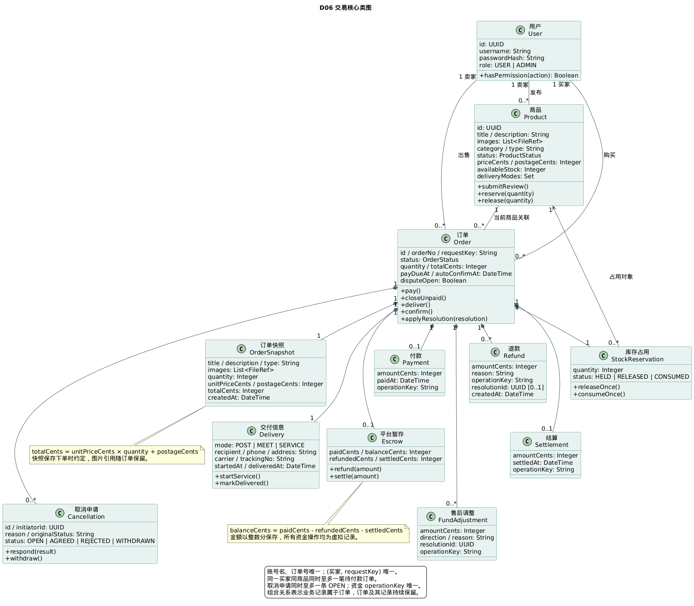

类的划分首先围绕一笔交易需要保留哪些事实展开。用一个 User 类表示账号，在商品和订单的关联中表达卖家、买家身份。每笔订单关联一种商品，购买多件同款商品通过数量字段表达，这与直接下单的业务范围对应，也让计价和库存占用都有明确的商品归属。

商品信息会持续变化，而订单需要保存双方下单时的约定，因此为订单建立独立的 OrderSnapshot。快照同时保存名称、描述、图片引用和邮费，后续客服处理也能读取当时的商品内容。这一设计将商品模块的日常维护与订单模块的历史记录衔接起来。

库存方面，仅有商品当前的可售数量，还需要知道每笔订单占用了多少。因此增加 StockReservation 与订单一对一关联，记录数量以及占用、释放或消耗状态。下单时由订单模块调用商品模块扣减可售量并建立占用，关闭时按该记录恢复数量，完成时标记消耗。这样可以直接说明某次数量变化来自哪笔交易，也为重复取消时判断是否已释放提供依据。

虚拟支付仍然需要表达款项处于哪个阶段，因此要将付款、平台暂存、退款和结算建成不同对象。买家付款形成 Payment 和 Escrow，确认完成后形成 Settlement，取消或客服处理形成 Refund。完成后的售后通过 FundAdjustment 保存调整金额，并关联处理意见，卖家统计就能解释原成交金额与后续到账变化。

这些对象都围绕订单建立关系，但各自记录不同的业务事实。商品模块维护当前可售内容，订单模块保存交易约定和进度，资金模块保存金额变化。这样的职责安排使后续实现能够从一笔订单查到快照、库存占用和资金记录，并逐项核对一次交易是否完整。

#### 2.3 沟通与治理类图

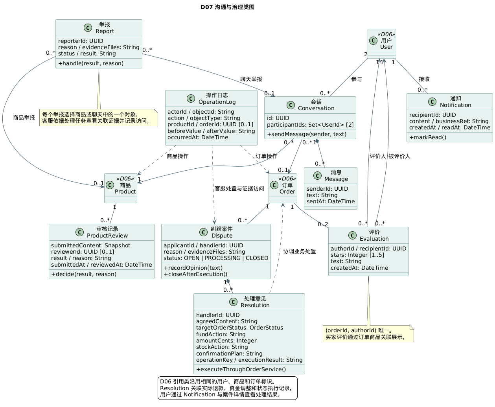

买家往往会先咨询商品，再决定是否下单，所以商品会话可以在订单创建前就建立，并在交易形成后关联订单。Conversation 保存参与者和业务关联，Message 保存具体消息，使同一段沟通能够随着交易继续使用。评价则发生在完成交易之后，Evaluation 直接关联订单及评价双方，通过“订单号＋评价人”确定唯一记录。商品页和个人评价页从这条记录获得相应展示内容，评价的来源也能追溯到具体交易。

审核和纠纷都需要保留多次处理的经过。因此为商品设置 ProductReview，保存每次提交的内容、审核结果和原因；为订单设置 Dispute，保存申请、证据和案件进度。商品再次提交审核、订单再次发生售后时，新的记录接续到同一业务对象，之前的处理依据仍可查询。这也是将沟通与治理单独划分模块的原因：这些记录有自己的处理过程，又需要持续关联商品和订单。客服意见最终要转化成订单、库存或资金变化，所以在案件中增加了 Resolution。它保存目标状态、资金动作、金额、库存动作及自动确认安排，再通过订单服务执行。例如，双方约定部分退款并继续履约时，案件模块记录这项约定，订单模块协调退款及后续状态，执行结果回写案件。客服可以据此判断处置进展，用户也能在订单和案件详情中看到相互对应的结果。

#### 2.4 用户入口活动图

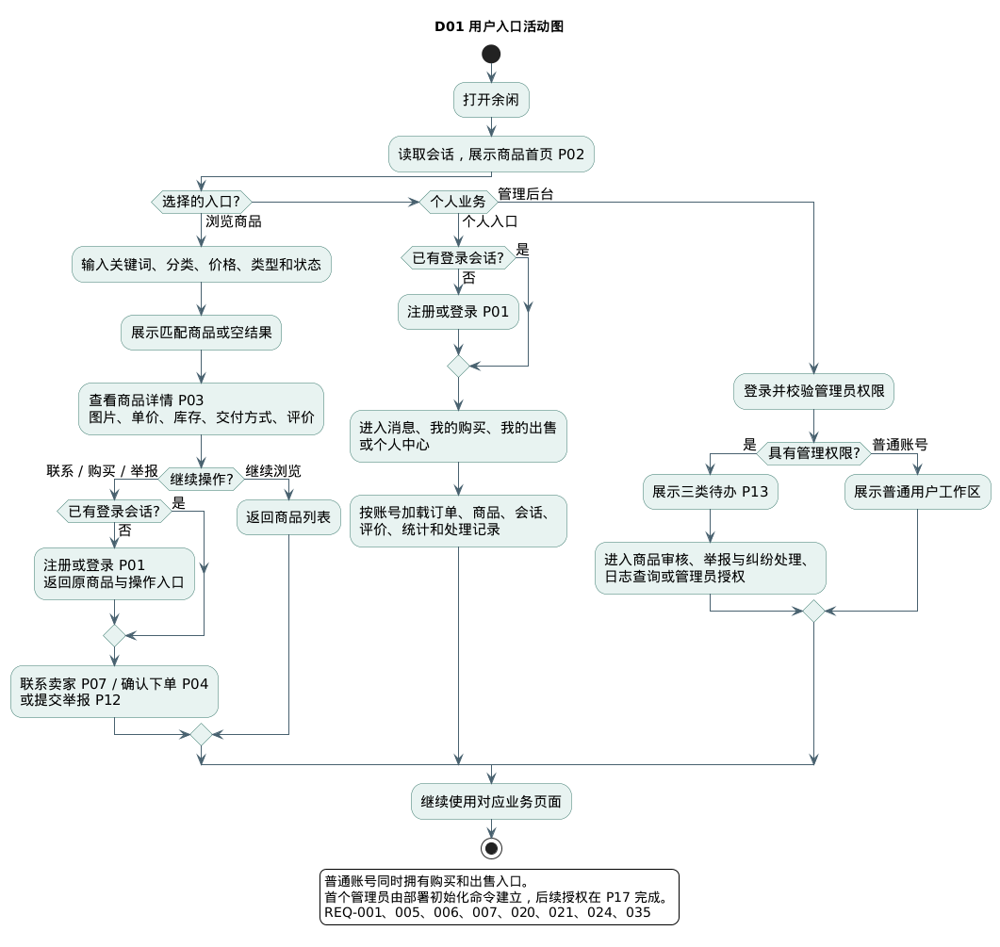

设计入口时，首先考虑用户打开软件后的目的。多数用户会先看有没有感兴趣的商品，再决定联系或购买。因此首页和公开商品详情直接承接浏览，账号模块在联系、购买、发布和查看个人业务时参与校验。登录后回到原来的商品或操作入口，用户可以接着完成刚才的任务。

普通账号同时具备买卖功能，所以顶部导航直接提供购买、出售和聊天入口，用户通过当前任务切换业务。进入购买列表时由订单模块查询本人订单，进入出售页面时由商品模块查询本人商品，进入聊天时由沟通模块加载相关会话。这里的入口划分与模块职责相互对应，也为界面中各类列表确定了数据范围。

管理员进入后台后首先查看待审核商品、举报和纠纷。这些工作分别属于商品与审核、举报与纠纷模块，由统计与审计模块汇总为待办入口。将待办作为管理侧起点，能够帮助管理员先找到需要处理的记录，再进入对应详情完成操作。

#### 2.5 交易过程活动图

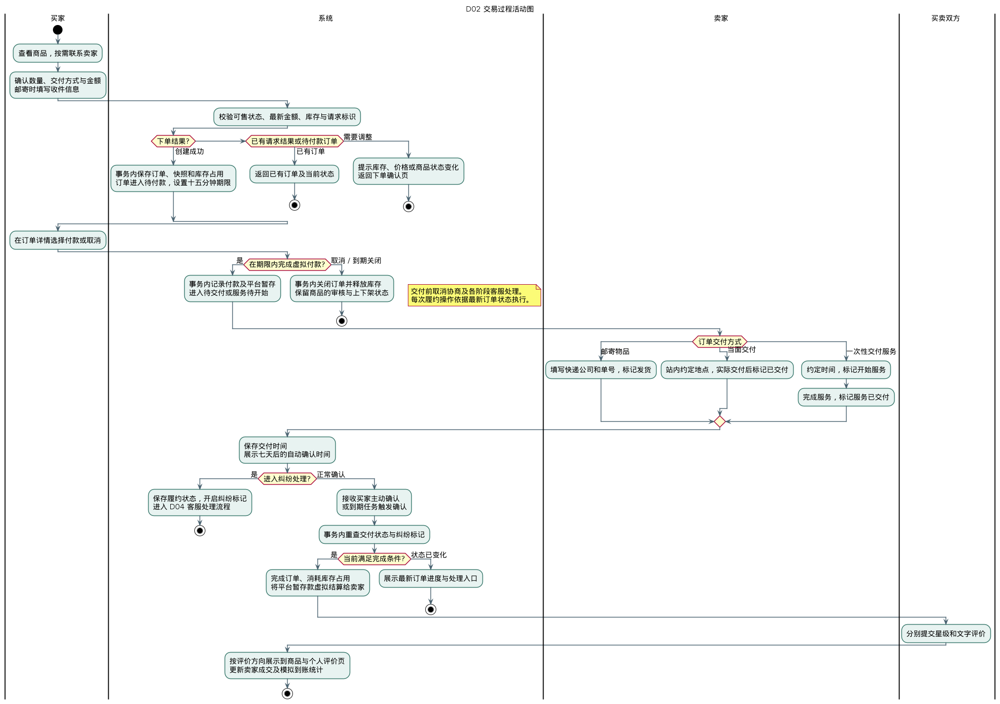

交易主流程是整个商品交易系统的核心。下单时商品、数量和价格已经由买家确认，将库存占用放在订单创建时完成，使待付款订单拥有对应的商品数量。商品模块提供库存操作，订单模块决定占用何时建立、何时结束，两者通过这段流程形成明确的协作关系。

付款与结算安排在交易的两个阶段。买家付款后，资金模块先记录平台暂存，订单模块据此开放履约操作；买家确认完成后，订单模块再协调结算。将结算放在交付确认之后，可以让交易进展与资金去向对应起来，交付前取消和客服退款也有明确的资金来源。

物品邮寄、当面交付和一次性交付服务都需要购买、付款及评价，因此我把它们组织在同一条交易主流程中，在履约阶段按交付方式展开。服务单独记录开始与交付，邮寄保存快递信息，当面交付保存实际交付时间。三种方式在交付后汇合，统一进入确认与结算，七天自动确认从各自的交付事件起算。

评价和统计接续在交易完成之后。沟通与评价模块依据完成订单开放双方评价，统计模块依据完成时间统计成交，依据结算时间统计模拟到账。活动图中的先后关系因此也确定了模块间的数据依赖，订单完成记录和资金结算记录，是后续评价与统计的业务依据。

#### 2.6 商品发布与维护活动图

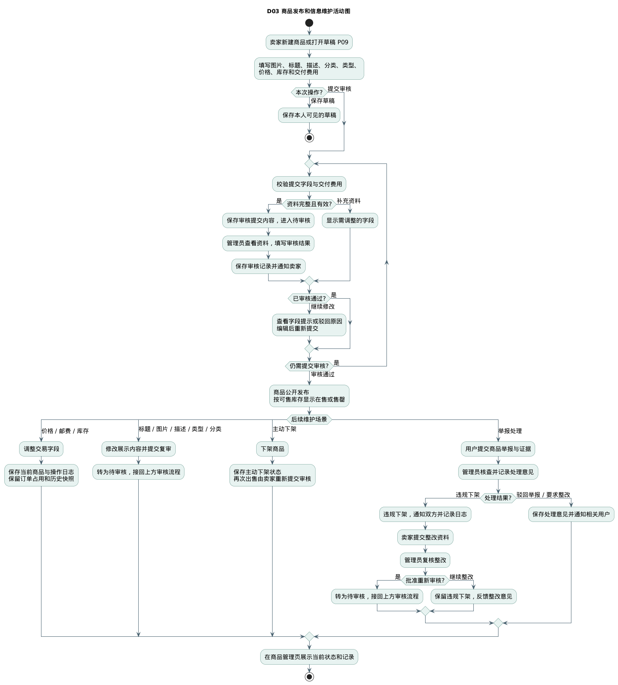

发布商品通常需要分几次填写文字、整理图片和核对价格，所以把草稿保存与提交审核分成两个动作。草稿保存当前编辑进度，提交审核时检查完整资料，并保存本次提交内容。商品模块负责这两个阶段，管理员对提交记录作出审核决定，沟通模块再把结果通知卖家。这一流程也决定了界面中草稿、待审核和出售中商品的组织方式。

商品发布后的修改需要结合其影响确定处理方式。价格、邮费和可售库存是日常交易调整，修改后作用于新的购买请求；名称、图片、描述、类型和分类决定买家看到的商品内容，因此修改后进入复审。已有订单通过快照保留原约定，继续按原交易内容履约。商品维护与订单履约能够各自推进，连接点是下单时确定的快照。

#### 2.7 取消与纠纷活动图

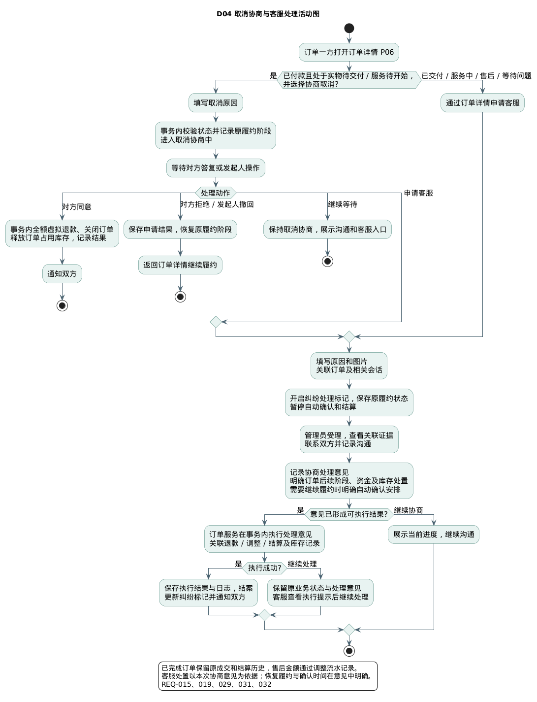

取消流程的设计取决于交易已经进行到哪一步。物品尚未交付、服务尚未开始时，双方可以通过一次取消申请确定是否结束交易。申请保存发起人、原因和原履约阶段，对方同意后，订单模块协调全额退款、关闭和库存释放；拒绝或撤回后恢复原阶段。保存原状态使同一套协商流程能够用于物品和服务订单。进入实际履约后，处理结果需要结合交付情况和双方约定。例如，已发货商品可能涉及退回商品和运费承担，已经开始的服务可能涉及已完成部分的费用。因此，我将这类问题交给案件模块组织证据与协商，由处理意见明确订单后续状态、资金和库存安排，再调用订单服务执行。模块之间的职责由这个处理过程确定：案件模块形成有依据的方案，订单模块协调业务变更，资金和商品模块完成各自的数据更新。案件在处置执行成功后结案，用户看到的处理结果就能对应到实际退款或履约变化。若交易已经完成，售后金额通过调整流水继续关联原订单，原成交和结算记录保留。卖家查看统计时可以沿调整记录找到案件及处理意见，理解金额变化的具体原因。

#### 2.8 商品状态图

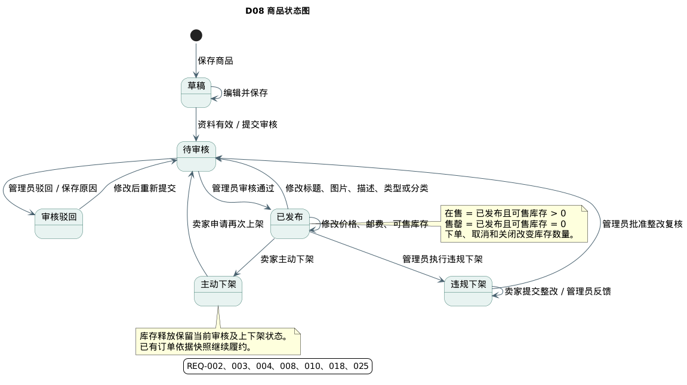

商品状态首先表达审核和上下架的管理过程：草稿准备资料，待审核等待决定，审核通过后发布，驳回后按意见修改。主动下架和违规下架分别保存，便于后续选择重新提交或整改复核的路径。这些状态为卖家编辑、管理员审核和买家购买提供共同的判断依据，页面上的操作按钮也从当前状态确定。

库存数量会随着交易频繁变化，因此我将“售罄”作为可售数量为零时的展示结果。例如，一件已发布商品被订单占用后显示售罄，订单取消释放数量后可以继续接受购买；如果卖家已经下架，释放数量后仍保持下架。商品是否能购买由发布状态与可售数量共同决定，订单模块只通过库存操作恢复数量，商品模块继续管理上下架状态。

#### 2.9 订单状态图

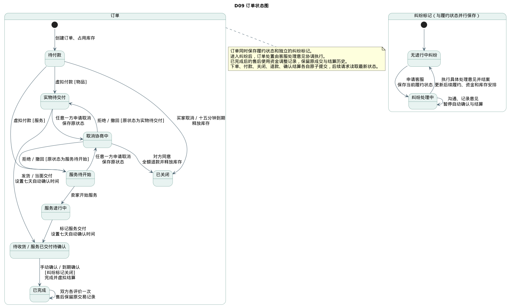

订单状态需要让买卖双方知道当前进度，也需要为后端判断下一步操作提供依据。物品付款后进入待交付，服务付款后进入待开始，并增加服务进行中阶段，因为“是否已经开始服务”会影响取消方式。两类订单在交付后统一进入待确认，完成时再结算，页面可以据此展示相应的操作和提示。

状态转换还确定了订单模块调用其他模块的时机。待付款转为已关闭时释放库存，取消协商转为已关闭时执行退款和释放，待确认转为已完成时执行结算并消耗库存占用。这些相关更新在同一事务中提交，使订单状态能够代表对应操作已经完成。手动确认和定时确认同时到达时，都从最新状态判断，已经完成的订单返回已有结果。

#### 2.10 直接下单时序图

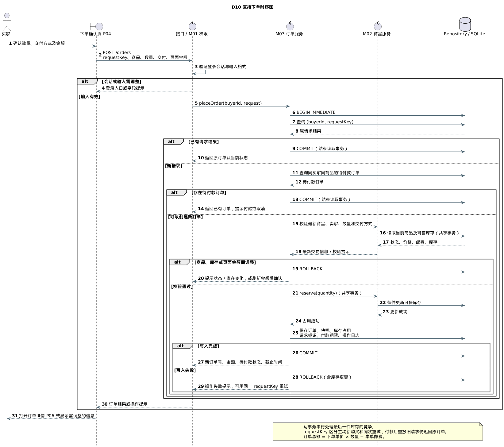

这个操作同时连接页面、账号、商品、订单和数据库，页面提交数量、交付信息、当前显示金额和请求标识，接口从登录会话确定买家身份，再交给订单服务。商品服务负责检查最新商品、卖家、交付方式与库存，订单服务根据这些结果创建交易。

首先查询同一买家和请求标识对应的订单。这考虑的是用户提交后网络响应延迟、再次点击的场景：两次请求应当得到同一次购买的结果。即使原订单后来已经付款，重试原请求仍返回原订单。新的主动购买使用新标识，再检查该买家是否已有同商品的待付款订单，引导用户先处理已有订单。这两项检查分别对应请求重试和交易中的待付款约束。读取最新价格、邮费和库存放在事务内，是因为用户看到商品详情后，卖家可能改价，也可能有其他买家下单。订单采用本次检查得到的价格和邮费生成快照；若它们与页面金额发生变化，则返回确认提示，让买家依据更新后的金额决定是否继续购买。库存检查、占用和订单保存使用同一个事务，使检查所依据的数据与本次写入衔接起来。

结合 SQLite 的单实例存储方案，在这里采用 `BEGIN IMMEDIATE`，让竞争最后一件商品的写事务依次处理。事务内完成库存更新以及订单、快照、占用记录和日志的保存，提交成功后返回订单号与付款期限，页面再进入订单详情。这张时序图具体说明了组件图中“订单协调商品和数据访问”的含义，也把类图中的几个对象落实到同一次下单操作中。

****

### 三、UI 设计与功能说明

#### 3.1 商品首页

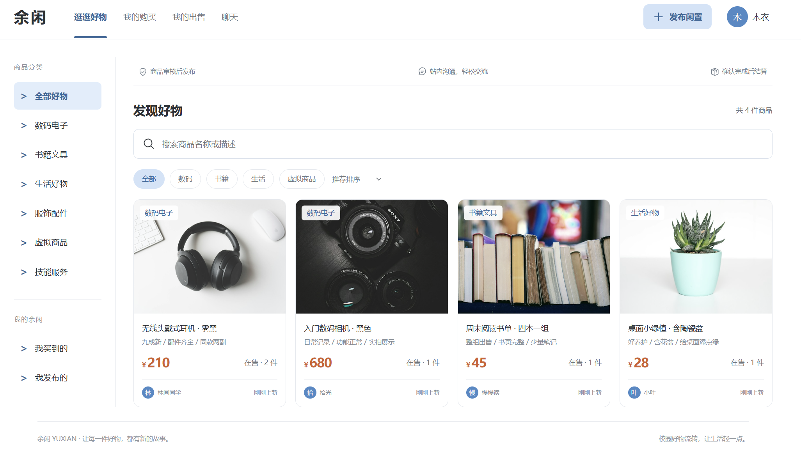

首页提供分类、搜索、商品列表和个人业务入口。左侧分类包含数码电子、书籍文具、生活好物、服饰配件、虚拟商品和技能服务等，并且在首页提供搜索框，用户进入页面后可以直接输入关键词。

商品卡片展示图片、名称、价格和卖家摘要，点击后进入详情。列表上方保留商品审核与交易规则的简短提示，主要展示空间用于商品本身。首页承担 M02 的商品发现功能，顶部导航将用户引向订单、出售和沟通业务。虚拟商品作为浏览分类加入现有分类体系，商品类型和交付约定继续由商品资料表达。分类帮助用户寻找内容，类型及交付方式则用于组织交易过程。

#### 3.2 商品详情与下单

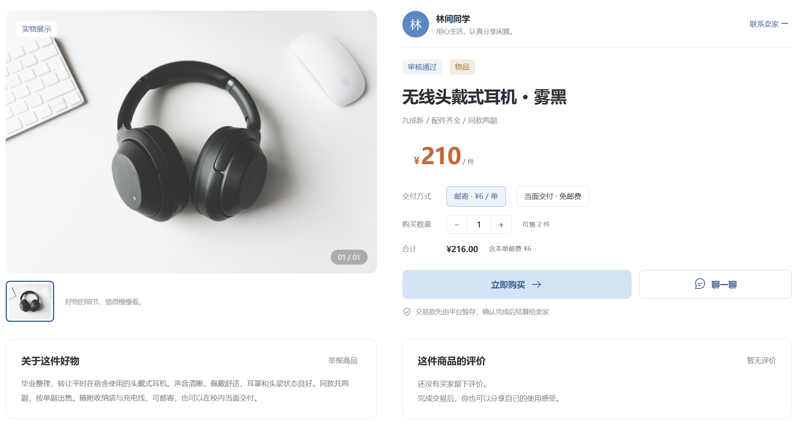

商品详情左侧展示主图和缩略图，右侧展示卖家、名称、价格、交付方式及购买数量，下方继续展示商品描述和评价。价格区域采用白底并缩小上下留白，使价格与数量、运费和总额靠近，方便买家一起核对。

截图中的耳机单价为 210 元，购买数量为 1，邮寄费用为 6 元，页面总额为 216 元。数量控件结合当前库存给出可购买范围，选择交付方式后更新金额。“立即购买”进入下单确认，“联系卖家”打开关联商品的聊天，用户可以从详情继续咨询或购买。

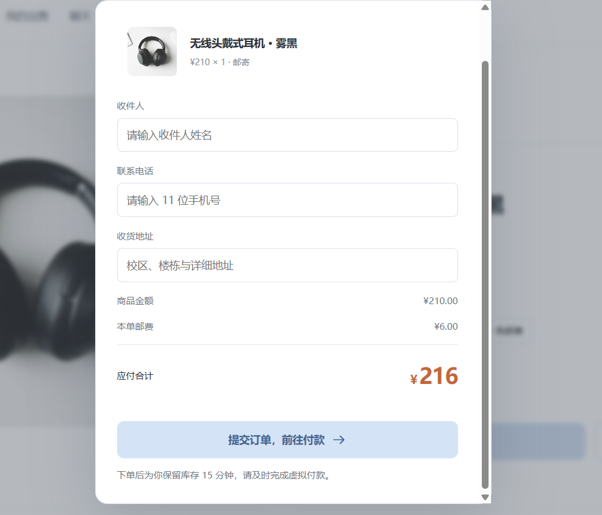

下单确认以弹窗展示所购商品、数量、交付方式和金额，商品摘要区域沿用白底。截图中的邮寄订单需要填写收件人、联系电话和收货地址，下方分项列出商品金额 210 元、本单邮费 6 元及应付合计 216 元。用户核对后点击“提交订单，前往付款”，进入订单详情完成虚拟付款；按钮下方提示下单后保留库存十五分钟，说明付款期限。商品资料来自 M02，订单创建由 M03 负责，付款记录由 M04 保存，咨询由 M05 承接。

#### 3.3 我的购买

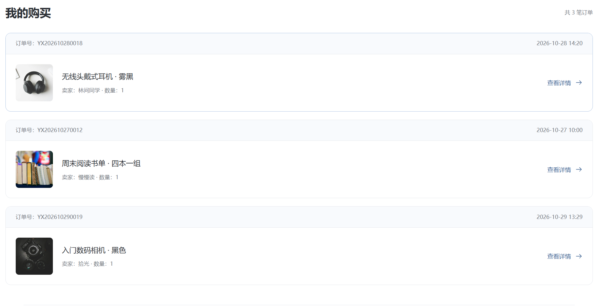

“我的购买”首先展示多笔订单的摘要，每条记录提供订单号、时间、商品名称、卖家和数量，并保留“查看详情”入口。用户可以先辨认目标订单，再进入详情查看具体价格、收货情况和可执行操作。

这种组织方式适合持续积累订单的使用场景。列表承担查找和选择功能，详情页围绕单笔交易展开，使多笔订单能够在同一页面中清楚排列。每笔订单使用各自保存的商品快照和交易记录，进入不同订单时展示相应的状态与操作结果。

#### 3.4 订单详情与交易操作

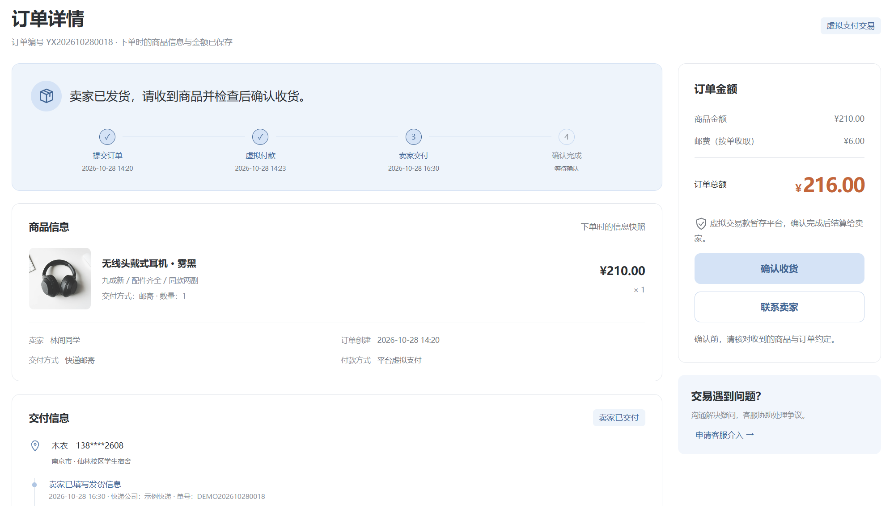

订单详情上方展示当前状态和交易进度，中间展示商品快照、交付与相关记录，右侧集中展示金额及主要操作。订单详情根据状态切换付款、取消、确认收货和评价入口。服务交易使用开始服务、已交付和确认完成等对应表述。买家通过聊天联系卖家，需要协助时进入客服处理，相关申请和结果继续关联当前订单。

#### 3.5 我的出售与发布商品

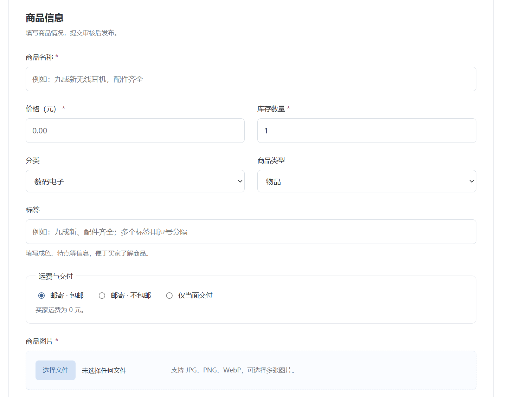

“我的出售”提供出售中的商品、发布商品、草稿和待审核等标签页。“发布商品”作为独立页面承接较长的填写过程，字段包含名称、价格、库存、分类、物品或服务类型、标签、运费、图片和描述。图片选择后可以预览并移除，运费通过包邮、填写运费或当面交付等选项表达。

截图展示名称到图片上传的表单上部，页面下部继续填写描述，并提供保存草稿和提交审核操作。草稿保留已经输入的内容，提交审核时检查完整资料，提交后商品进入待审核列表。这些界面状态对应商品活动图和商品状态图中的草稿、提交与审核过程。

出售列表在没有商品时仍可以进入，显示“当前暂无商品正在出售”，用户从同一页面继续切换到发布商品。这样的空状态使新用户能够理解当前位置，并自然开始第一次发布。商品编辑和审核进度由 M02 承接，管理端审核结果通过通知反馈给卖家。

#### 3.6 聊天与客服入口

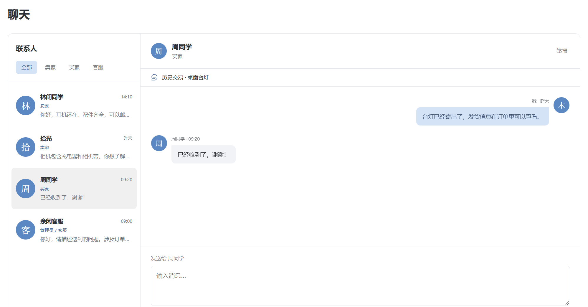

聊天作为独立的一级入口，左侧选择联系人，右侧查看历史消息和发送内容。联系人按卖家、买家和客服提供筛选入口，既支持购买前咨询，也支持出售后的交易沟通。当前选中的联系人使用浅灰色背景，头像统一使用蓝底白字。消息窗口上方展示会话对象及相关商品入口，“查看商品”区域采用白底。选择不同联系人时切换对应消息记录和输入内容，用户可以在多段交易沟通之间继续交流。客服会话为订单问题提供沟通入口，涉及正式处置时由案件记录保存原因、证据和处理结果。

独立聊天页让用户能够集中处理来自不同交易方的消息。商品和订单关联提供沟通上下文，M05 管理消息，M06 管理需要客服执行的业务处置，二者通过相关业务标识连接。

****

### 四、辅助工具使用与修改过程

本次使用 Codex 辅助整理需求覆盖表、编写 PlantUML 源码、制作 HTML/CSS/JavaScript 原型和整理报告初稿。PlantUML 负责把图形源码渲染为 PNG，Chrome 用于实际操作界面和截取最终页面。需求范围、页面组织和视觉修改由我结合实验一内容与浏览器中的实际效果提出，再通过工具完成相应调整。

让 Codex 调整前端的过程中，影响较大的部分是发布页、聊天页和购买列表。发布商品需要填写图片、运费和描述，独立页面更适合持续编辑；聊天需要选择不同交易对象，因此需要联系人列表；购买订单会不断增加，因此先呈现摘要，再展开具体交易。这些调整来自实际使用过程，也改变了原型的信息组织方式。
