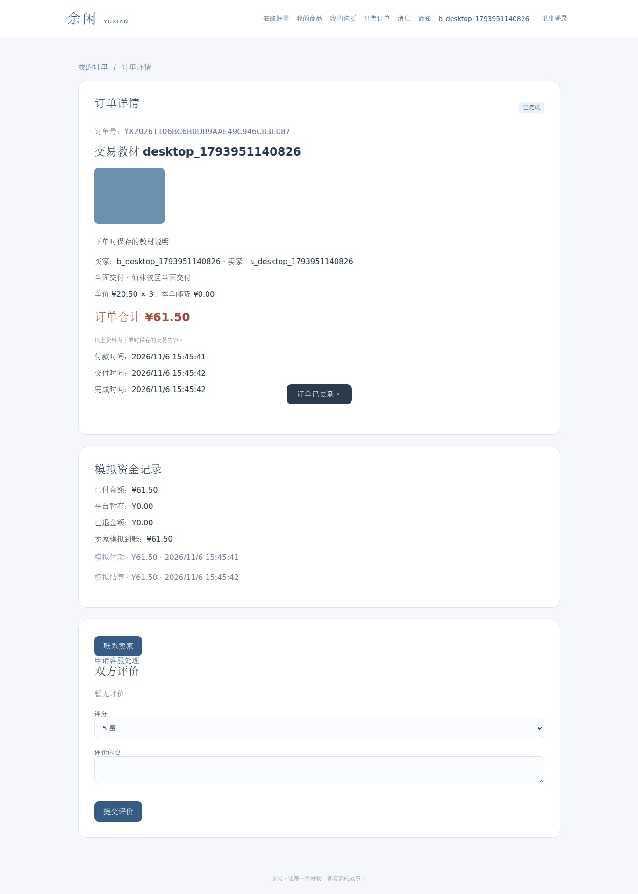
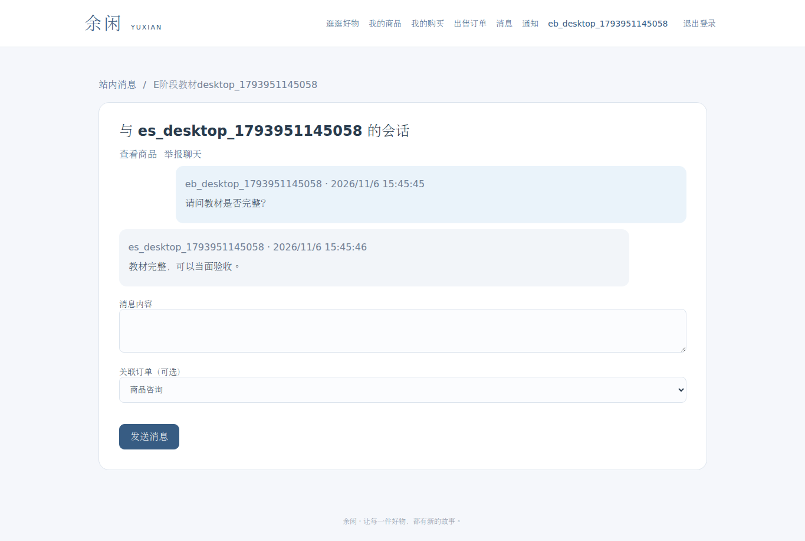

<b> 软件实现与构建实验报告 </b>

寇裕林 241220001

### 一、技术方案与运行方式

本实验将“余闲”二手交易系统进行前后端的实现。后端使用 Python 和 Flask，前端使用 HTML、CSS 与 JavaScript，业务数据由 SQLite 保存。系统采用单实例服务器与多个客户端的运行方式。服务器启动后持续监听请求，不同客户端通过各自的登录会话访问同一套业务数据。

### 二、从 UML 模型到代码实现

#### 2.1 组件图到代码目录

UML 组件图按账号、商品、订单、资金、沟通、案件和查询划分职责。实现时，我保留这些业务边界，并在后端内部进一步划分接口层、服务层和数据访问层。接口层处理请求与响应，服务层组织业务判断和事务，数据访问层集中执行 SQL。

| UML 中的组件或职责 | 实现位置 | 主要作用 |
| --- | --- | --- |
| 浏览器界面 | ``web/index.html``、``web/js/pages/``、``web/css/`` | 展示商品、订单、聊天及管理页面，收集操作输入 |
| HTTP 访问与身份入口 | ``app/api/``、``app/security.py`` | 解析参数、识别登录用户、校验 CSRF、返回统一响应 |
| 账号与权限 | ``app/services/auth.py`` | 注册、登录、会话撤销及管理员授权 |
| 商品与审核 | ``app/services/products.py`` | 草稿维护、审核、上下架与库存操作 |
| 订单与模拟资金 | ``app/services/orders.py``、``app/services/funds.py`` | 协调下单、付款、交付、完成及资金流水 |
| 沟通、案件与查询 | ``app/services/social.py``、``cases.py``、``queries.py`` | 消息、评价、案件处置、统计和审计查询 |
| 数据持久化 | ``app/repositories/``、``app/schema.sql``、``app/migrations/`` | 数据读写、约束、索引和结构升级 |

#### 2.2 类图到业务对象和数据库

类图描述了业务对象之间的关系。转换为代码时，适合表示请求和身份的数据使用 Python 数据类，持续保存的业务事实映射到数据库表，涉及多项规则的操作放入服务类。

| UML 对象 | 当前代码或存储形式 | 映射说明 |
| --- | --- | --- |
| ``User`` | ``users`` 表、``Actor``、``AuthService`` | 账号统一保存，买卖身份由商品和订单关系确定 |
| ``Product``、``ProductReview`` | ``products``、``product_reviews`` 表及 ``ProductService`` | 保存当前商品、审核批次与提交内容 |
| ``Order`` | ``orders`` 表及 ``OrderService`` | 保存交易参与者、金额、状态与时间，组织交易操作 |
| ``OrderSnapshot`` | ``orders.snapshot_json``、``order_images`` | 保存下单约定和历史图片引用 |
| ``StockReservation`` | ``orders.quantity``、``reservation_state`` | 将一笔订单的占用数量与占用状态保存在订单中 |
| ``Payment``、``Refund``、``Settlement`` | ``fund_transactions`` 表及 ``FundService`` | 按流水类型区分付款、退款和结算 |
| ``Escrow`` | ``FundService.get_escrow`` 的汇总结果 | 根据已有流水计算订单暂存余额 |
| ``Conversation``、``Message``、``Evaluation`` | ``conversations``、``messages``、``evaluations`` 表 | 保存会话、消息和关联完成订单的评价 |
| 举报、纠纷与处理意见 | ``cases`` 及关联记录、``CaseService`` | 通过案件类型统一组织受理、证据、说明与处置 |

#### 2.3 活动图、状态图到业务规则

活动图中的每一步被落实为前端操作和后端服务，状态图中的迁移条件则成为服务执行前的判断。以当面交易为例，下单创建 ``UNPAID`` 订单；买家付款后进入 ``WAITING_DELIVERY``；卖家标记实际交付后进入 ``DELIVERED``；买家确认完成后进入 ``COMPLETED``。待付款订单也可以因买家关闭或到期检查进入 ``CLOSED``。

商品状态图落实为草稿、待审核、已发布、审核驳回、主动下架和违规下架等状态。修改价格和可售数量会影响后续购买，修改标题、描述、图片等内容会进入复审。商品售罄通过可售数量为零表达，因此订单关闭后恢复库存时，商品原有的上下架状态能够继续保留。（``app/services/products.py``）。

页面根据状态展示可执行按钮，后端在请求到达时再次读取最新状态。卖家旧页面提交修改时，需要携带 ``version``；若其间发生库存变化或其他编辑，服务返回版本冲突，用户刷新后再确认。状态图由此同时参与页面交互和数据更新，覆盖用户打开页面后业务状态继续变化的情况。

直接下单对应的调用顺序是：商品页面提交请求，接口解析购买参数并取得买家身份，订单服务进入写事务，读取最新商品和订单数据，调用库存操作，保存订单及日志，提交后返回订单详情。客户端提交的金额用于表达用户确认过的报价，实际总额由服务器依据最新商品数据重新计算。

### 三、关键实现与项目特色

#### 3.1 订单快照与交易约定保留

二手商品的资料会随着卖家维护而变化，已建立的交易需要持续保留下单时的内容。因此，创建订单时将商品标题、描述、分类、卖家名称、图片引用、单价、数量、交付约定和总额写入快照。订单详情从快照显示交易内容，商品详情继续展示当前资料。例如，买家按某一价格购买后，卖家可以调整商品后续售价，已创建订单仍按原金额付款和结算。图片也通过 ``order_images`` 保留与订单的关联，后续查看交易或处理案件时能够找到原始资料。快照同时为售后沟通和审计提供依据。客服处理案件时可以围绕当时的约定核对交易，卖家统计也依据订单和资金记录计算，商品资料的后续修改能够与历史交易保持清晰联系。

#### 3.2 库存、状态与模拟资金的一致性

并发控制首先围绕“最后一件商品”展开。两个买家同时下单时，各自的写事务依次取得写入机会，并在事务内读取最新库存。实际扣减还要求商品处于发布状态且 ``available_stock`` 足够，服务依据更新行数判断是否成功。

重复提交通过请求标识和数据库约束处理。订单使用 ``request_key`` 识别一次购买请求，用购买内容指纹检查重试内容；部分唯一索引限制同一买家对同一商品最多保留一笔待付款订单。付款和结算也按订单与流水类型保持唯一，重复操作可返回已有结果。用户在网络延迟后再次点击时，页面能够取得已完成的操作结果。

事务范围也覆盖日志和通知。若处置中途写入失败，订单、资金、库存和相关记录整体回滚。付款期限在取得写事务后判断，因此请求即使在等待锁期间越过截止时间，也会依据实际执行时刻处理。对已到期订单，先提交关闭与库存释放，再向客户端返回到期提示，使页面提示能够对应数据库中的最终结果。

### 四、大模型协作与审查过程

#### 4.1 分阶段协作方式

本次开发使用 Codex 辅助实现。我先提供需求分析、UML、实验手册和课程范围，确定 Python、Flask、SQLite 的技术方案，再要求模型规划目录与开发顺序。目录采用 ``app`` 和 ``web`` 作为运行代码入口，开发说明放入 ``notes``。每个阶段的任务都包含代码实现、对应测试和开发报告，便于依据可运行结果继续讨论。

| 阶段 | 交给模型的主要工作 | 我提出的约束或安排 |
| --- | --- | --- |
| A：账号基础 | 应用工厂、数据库、注册登录、会话、权限和基础页面 | 接口、业务与数据访问解耦，使用已有 base 环境 |
| B：商品管理 | 商品编辑、图片、审核、查询、上下架和数据库升级 | 沿用已有分层结构，完成前后端联通及测试 |
| C：核心交易 | 下单、库存占用、快照、付款、交付和结算 | 重点处理并发，验证重复请求和最后一件商品竞争 |
| D：沟通与管理 | 聊天、通知、评价、举报、纠纷、统计和审计 | 调整开发顺序，先在当面交易基础上完成周边功能 |

#### 4.2 生成结果不符合预期时的处理

生成结果的修正以具体约束和可复现问题为依据。对于功能范围和结构，我直接补充任务要求；对于执行失败，由模型结合错误信息定位原因、修改相关代码，再运行对应验证。开发记录中有以下几类具体调整。

**目录与实现范围。** 我明确要求根目录使用直接可读的业务目录，并指定开发笔记和开发辅助目录的 Git 忽略规则。交易优先完成当面交付，邮寄、服务履约及定时任务按后续阶段安排。这些约束使模型后续生成的文件位置和功能范围与项目计划保持一致。

**真实 HTTP 验收中的中文查询。** 商品阶段的首轮验收脚本直接拼接中文查询参数，实际请求暴露了 URL 编码问题。修正后使用 URL 参数编码构造请求，并重新运行验收。这个问题说明，接口测试需要经过实际 HTTP 路径，才能检查脚本请求构造与服务器接口的配合。

**旧版本数据库迁移样本。** D 阶段新增通知后，构造旧库样本的测试需要按旧版本行为写入审核记录，才能准确模拟升级前的数据结构。修正后的测试从非空旧库出发，核对账号、会话、商品图片、订单和资金保留情况，并验证升级失败时的回滚。

**证据访问与案件结案的并发。** 对证据访问流程的检查进一步明确了授权与留痕的事务范围。实现调整为在同一事务中完成权限判断和查看日志，并通过事件同步测试控制“读取等待锁、另一操作结案”的执行顺序，确认等待结束后会使用最新权限。管理员撤权场景也进行验证。

#### 4.3 人工的代码审查与手动验收

为理解生成代码，我要求模型按“用户注册到交易完成”整理阅读路径：从注册页面和请求封装进入账号接口，继续查看身份检查，再沿商品发布、审核、下单、付款和结算阅读对应服务与数据库操作。我还单独追问了 ``make run`` 之后的执行顺序，将服务器启动、请求处理和事务提交区分开来，形成后续逐文件审查的入口。

我重点关注交易金额由哪里计算、库存何时占用、重复点击如何处理，以及关闭服务器后数据如何保存。围绕这些问题查看接口和服务之间的关系，可以把页面行为与具体代码联系起来；其中订单服务负责组织事务，资金和库存方法在事务内部协作，是理解整个交易过程的关键。

手动验收使用 ``admin``、``buyer``、``seller`` 三个账号，在本机浏览器中通过退出和登录切换角色，完成商品发布与审核、买家下单付款、卖家交付和买家确认。实际测试商品为一件 288 元的耳机。完成后又通过只读数据库查询核对账号、商品、订单与资金记录，确认订单已完成、占用已消耗，并各有一笔 288 元的付款和结算流水。聊天、评价及案件处理的验证结果另外来自自动化测试记录。

### 五、源代码规模与提交版本对应

本报告对应 ``main`` 分支上的 ``a0e21f7`` 提交，提交说明为 ``app v1.0.0``。2026 年 11 月 12 日执行代码统计时，运行代码与该提交一致。使用 ``make PYTHON=/home/kouyulin/miniconda3/bin/python count`` 统计得到：后端 ``app`` 中的 Python 与 SQL 文件共 44 个；前端 ``web`` 中的 HTML、CSS、JavaScript 与 SVG 文件共 30 个；合计为 74 个文件。

### 六、软件运行与测试结果

#### 6.1 完整交易运行展示

实际运行中，卖家进入“我的商品”建立商品、上传图片并提交审核，管理员在审核页面通过后，买家可以在首页查询并进入详情。买家确认数量与金额后创建订单，完成模拟付款；卖家在出售订单中标记交付，买家确认完成后，订单页面展示已完成状态和结算结果。

下图取自浏览器回归测试。测试商品为教材，单价 20.50 元、购买数量 3 件，订单总额为 61.50 元。页面同时展示下单快照、付款和交付时间，以及已付 61.50 元、暂存 0 元、卖家模拟到账 61.50 元的资金结果。

聊天页面支持买卖双方围绕商品交换文本消息，并可关联双方的订单。下图记录了测试账号的一次实际消息往返，页面内容来自后端保存的会话与消息记录。

几天后复核时，订单 ``YX202611093EE379863A137395BABFF8E8`` 的状态为 ``COMPLETED``，数量为 1，总额为 28,800 分，库存占用为 ``CONSUMED``；商品可售库存为 0，付款和结算流水各为 28,800 分。这些记录与浏览器完成交易的结果一致，说明数据库持久化功能正常。

#### 6.2 功能与异常测试

本节汇总 D 阶段完成后的验证记录。后端测试逐步覆盖 A、B、C、D 阶段，浏览器测试覆盖桌面与窄屏视口，真实 HTTP 验收则启动服务器，通过独立客户端检查业务结果。

| 验证项目 | 实际结果 | 主要内容 |
| --- | --- | --- |
| pytest 后端测试 | 253 项通过，耗时 66.56 秒 | 业务服务、接口、权限、并发、迁移和异常回滚 |
| 后端覆盖率 | 语句 96.83%，分支 89.51%，综合 95.20% | 语句覆盖 2,074/2,142，分支覆盖 546/610 |
| Playwright 浏览器测试 | 30 项通过，耗时 37.2 秒 | 15 个场景分别在桌面和窄屏视口执行 |
| A、B、C 阶段 HTTP 回归 | 分别通过 11、14、18 项核对 | 账号、商品审核及核心交易 |
| D 阶段 HTTP 验收 | 22 项核对通过 | 聊天、评价、案件、统计、通知及重启保留 |

**并发与重复请求。** 核心交易测试覆盖两人争抢最后一件商品、16 人争抢 5 件商品、并发重复下单、付款和结算，以及付款与关闭之间的竞争。相关测试核对最终成功订单数、剩余库存和流水数量。D 阶段 HTTP 验收还同时发送了 6 次相同消息请求，最终只创建 1 条消息，验证了消息重试的幂等处理。

**异常与回滚。** 测试包含价格变化、库存不足、旧版本修改、无关账号访问订单和证据、等待锁后付款到期等场景。通过注入日志或通知写入失败，检查退款、结算及案件处置是否整体回滚。数据库升级测试使用包含账号、会话、图片和完成订单的旧版本数据，验证正常升级后的保留情况以及失败后的结构与数据恢复。

#### 6.3 性能与持久化验证

商品查询性能测试使用 1,000 条商品数据、5 个并发客户端，预热 10 次后发出 100 次正式请求，查询覆盖关键词、分类、商品类型、价格区间和售罄条件。测试运行于本机 WSL2 环境，记录的逻辑处理器数量为 20，可见内存约 47 GiB。100 次请求全部正确返回，全部在 2 秒内完成，最大耗时约 0.255 秒，达到需求中“至少 95 次在 2 秒内返回，全部在 5 秒内正确返回”的目标（``.cache/benchmark-e.json``）。

持久化验证通过关闭并重新启动测试服务器，继续核对消息、案件、资金与有效会话记录。日常数据保存在 ``instance/yuxian.sqlite3``，图片保存在 ``instance/uploads``，会话签名密钥保存在 ``instance/secret.key``。业务写操作在事务提交时保存到数据库，因此正常关闭服务器后，下次使用同一数据目录启动仍能读取之前的账号和交易；登录会话按自身有效期判断，过期后重新登录即可查看原有数据。

### 七、Git 仓库与版本信息展示

项目使用 Git 管理需求、UML、代码和报告，配置的远程仓库为 [kouylty/nju-csse](https://github.com/kouylty/nju-csse)。本地 ``origin`` 的获取与推送地址均为 ``git@github.com:kouylty/nju-csse.git``，当前开发分支为 ``main``。

| 本地提交 | 提交说明 | 对应内容 |
| --- | --- | --- |
| ``b3c2c7b`` | ``Initial commit`` | 项目仓库建立 |
| ``d77f9db`` | ``Lab1-ai-draft`` | 需求分析初稿 |
| ``fea9791`` | ``Lab1-final`` | 需求分析修订 |
| ``55fbac4`` | ``Add report-1`` | 实验一报告 |
| ``87d84c6`` | ``Lab 2 complete`` | UML 建模与实验二材料 |
| ``a0e21f7`` | ``app v1.0.0`` | 当前可运行的软件实现 |
